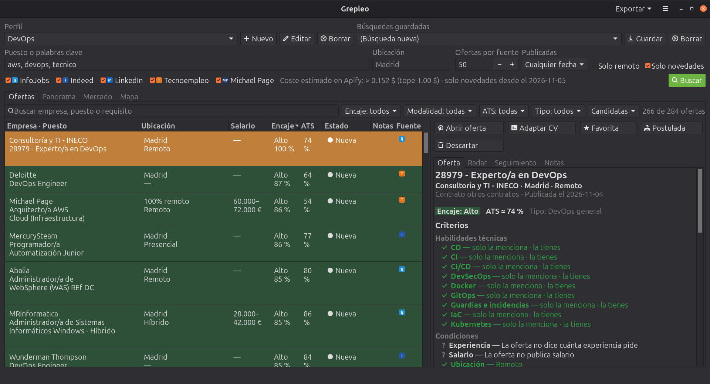

  

<h1 align="center">Grepleo</h1>

  
  
  
  
  
  
  
  
  
  
  
  

## 🇪🇸 Español

  Busca empleo en InfoJobs, Indeed, LinkedIn, Tecnoempleo y Michael Page, y comprueba qué criterios cumples en cada oferta.

  

Aplicación de escritorio (GTK 4 + PyGObject, interfaz en español e inglés), de uso personal: sin servidor ni cuenta
propios, solo tu token de [Apify](https://apify.com/) para lanzar las búsquedas (Michael Page se lee directamente de
su web y no lo necesita).

- **Una búsqueda, cinco fuentes:** el puesto o las palabras clave, la ubicación y la fecha de publicación se
  lanzan a la vez en InfoJobs, Indeed, LinkedIn y Tecnoempleo (a través de Actors de Apify) y en Michael Page (leída
  directamente de su web, sin coste), y las ofertas repetidas entre fuentes se unifican.
- **Qué criterios cumples:** cada oferta se evalúa frente a tu **perfil** (tus habilidades técnicas y blandas, **cada una con un
  nivel de 0 a 10** que pones en una ventana con la escala de niveles a la vista, y sinónimos, experiencia, estudios, idiomas con nivel, salario mínimo, modalidad, ubicación y lo que
  prefieres no encontrar) y muestra ✓ cumple, ✗ no cumple o ? no se puede saber, además de un encaje Alto, Medio
  o Bajo.
- **Honesta con lo que no sabe:** las fichas resumidas (cuando una fuente no trae la descripción completa) no la tienen, así
  que un requisito que no aparece queda como «no se sabe» y no cuenta en tu contra.
- **Varios perfiles** y **búsquedas guardadas**; las ofertas se guardan en tu equipo y las marcas como
  favoritas, postuladas o descartadas. Cada oferta tiene su **seguimiento**: fase del
  proceso (fase final, suspendido, rechazado…), próximos pasos, un **histórico** de contactos, entrevistas y pruebas,
  un **recordatorio** con fecha que te avisa al abrir la aplicación y tus **notas**.
- **Radares de competencias:** en el panel de cada oferta, uno general y los que definas en tu perfil por temas (Cloud,
  Lenguajes, Metodologías…), cuyos ejes son cosas concretas que aparecen en las ofertas con tu nivel de 0 a 10. Tu
  polígono (más intenso hacia los extremos) se superpone a lo que pide la oferta y cada radar da su **porcentaje de
  solape**; arriba, el solape global: cuanto más superpuestos, más posibilidades de encaje.
- **Compatibilidad ATS estimada:** un porcentaje por oferta de si tu CV pasaría el filtro automático con el que muchas
  empresas criban los currículums, con su veredicto, su fiabilidad, las palabras clave que tu CV no cita y los
  requisitos eliminatorios que no cumples. Es una estimación local y explicada, no un dato oficial: cada empresa
  configura su ATS. Cada radar lleva además una leyenda lateral que explica eje por eje lo que se ve.
- **Mapa:** las ofertas que ves como puntos sobre un mapa claro u oscuro, con el color de su encaje (necesita `gir1.2-shumate-1.0`; las imágenes y la búsqueda de ubicaciones son de OpenStreetMap, ver la política de privacidad).
- **Plan de estudio:** en los huecos del Panorama y en Mercado, cada habilidad que te falta enlaza con certificaciones oficiales y con búsquedas de cursos en Udemy y Coursera (en español y en inglés).
- **Mercado:** tus radares frente a lo que piden, de media, las ofertas que estás viendo (con las de encaje alto o medio, si quieres), para ver de un vistazo en qué temas te quedas corto.
- **Panorama:** qué requisitos se repiten en la muestra y qué se puede concluir contando (lo más pedido, lo que conoces y ninguna oferta cita, lo que dominas y pocas ofertas piden, **qué te falta más veces** (cuadro rojo con lo que piden tus ofertas y no cubres) y **tus puntos fuertes** (cuadro verde con lo que ya tienes y más piden), cuántas ofertas publican salario, cuántas son remotas…).
- **Exporta** lo que ves a un informe HTML autocontenido o a una tabla CSV.
- **Control del gasto:** antes de buscar ves una estimación del coste en Apify, y cada búsqueda lleva un tope de
  gasto que tú configuras.
- **Modo claro y oscuro** con los iconos del sistema, y **español e inglés** con selector de idioma.

## Documentación

Toda la documentación —instalación, guía de uso, especificaciones técnicas, solución de problemas y más— está en
la **[wiki del proyecto](https://github.com/seguidodoblado/grepleo/wiki)** (español e inglés).

## Servicios de terceros

Grepleo usa [Apify](https://apify.com/) para obtener las ofertas, y en concreto **Actors de la comunidad** de
Apify (de sus autores, no de Apify) que acceden a InfoJobs, Indeed, LinkedIn y Tecnoempleo. Esos sitios no ofrecen una API
pública de búsqueda y sus condiciones de uso restringen el acceso automatizado: el uso es personal y responsabilidad
de quien lo lanza. Los Actors pueden dejar de funcionar o cambiar sin avisar.

**Michael Page** es la excepción: la aplicación lee directamente su web pública (michaelpage.es) desde tu equipo, solo
las rutas de búsqueda y de ficha que su `robots.txt` permite, con pausas entre peticiones y un máximo de ofertas por
búsqueda. No pasa por Apify ni cuesta nada, pero depende del diseño de esa web y puede dejar de funcionar si cambia.

**OpenStreetMap** (solo si abres la pestaña Mapa): sus servidores sirven las imágenes del mapa y la búsqueda de cada ubicación distinta, una sola vez (Nominatim), con su límite de una petición por segundo; no reciben tus ofertas, tu perfil ni tus búsquedas, solo tu IP, la zona que miras y el texto de cada ubicación.

## Privacidad

Grepleo no tiene servidor ni cuenta propios y no recoge datos. A Apify solo se envían las palabras clave, la
ubicación y los filtros de cada búsqueda, y tu token para autorizarla; **tu perfil y tus criterios no salen de tu
equipo**. Qué se guarda y dónde está en la **[política de privacidad](PRIVACY.md)**.

## Licencia

Este proyecto se distribuye bajo la [PolyForm Noncommercial License 1.0.0](https://polyformproject.org/licenses/noncommercial/1.0.0) (ver `COPYING`): puedes usarlo, copiarlo y modificarlo para fines **no comerciales**; el uso comercial requiere permiso del autor. Es una licencia de «código disponible», no de software libre según la definición de la FSF/OSI.

---

## 🇺🇸 English

  Search for jobs on InfoJobs, Indeed, LinkedIn, Tecnoempleo and Michael Page, and check which criteria you meet in each offer.

  

Desktop application (GTK 4 + PyGObject, interface in Spanish and English), for personal use: no server or account
of its own, only your [Apify](https://apify.com/) token to run the searches (Michael Page is read directly from its website and
does not need it).

- **One search, five sources:** the position or keywords, the location and the posting date are sent at once to
  InfoJobs, Indeed, LinkedIn and Tecnoempleo (through Apify Actors) and Michael Page (read directly from its website,
  at no cost), and offers repeated across sources are merged.
- **Which criteria you meet:** each offer is evaluated against your **profile** (your technical and soft skills, **each with a
  level from 0 to 10** that you set in a window with the level scale in view, and synonyms, experience, education, languages with level, minimum salary, work mode, location
  and what you would rather not find) and shows ✓ met, ✗ not met or ? cannot be known, plus a High, Medium or Low
  fit.
- **Honest about what it does not know:** summary cards (when a source does not bring the full description) do not have it, so
  a requirement that does not appear stays as "cannot tell" and does not count against you.
- **Several profiles** and **saved searches**; offers are stored on your computer and you can mark them as
  favourite, applied or discarded. Each offer has its own **follow-up**: process
  stage (final stage, suspended, rejected…), next steps, a **history** of contacts, interviews and tests, a dated
  **reminder** that warns you when the application opens and your **notes**.
- **Skills radars:** in each offer's panel, a general one and those you define in your profile by topic (Cloud,
  Languages, Methodologies…), whose axes are concrete things that appear in offers, with your level from 0 to 10.
  Your polygon (more intense towards the edges) is overlaid on what the offer asks and each radar gives its **overlap
  percentage**; at the top, the overall overlap: the more they overlap, the better the chances of fit.
- **Estimated ATS compatibility:** a percentage per offer of whether your CV would pass the automatic filter many
  companies use to screen CVs, with its verdict, its reliability, the keywords your CV does not cite and the
  knock-out requirements you do not meet. It is a local, explained estimate, not an official figure: each company
  configures its own ATS. Each radar also has a side legend that explains, axis by axis, what you are seeing.
- **Map:** the offers you see as points on a light or dark map, in the colour of their fit (needs `gir1.2-shumate-1.0`; the images and the location lookup come from OpenStreetMap, see the privacy policy).
- **Study plan:** in the Overview gaps and in Market, each skill you lack links to official certifications and to course searches on Udemy and Coursera (in Spanish and English).
- **Market:** your radars against what the offers you are looking at ask for on average (or only the high or medium fit ones), to see at a glance on which topics you fall short.
- **Overview:** which requirements repeat across the sample and what can be concluded by counting (most
  requested, what you know that no offer mentions, what you master that few offers ask for, **what you lack most often** (a red card with what your offers ask for and you do not cover) and **your strengths** (a green card with what you already have and they ask for most), how many offers publish a salary, how many are remote…).
- **Export** what you see to a self-contained HTML report or a CSV table.
- **Spending control:** before searching you see an estimate of the cost on Apify, and every search has a
  spending cap that you configure.
- **Light and dark mode** with system icons, and **Spanish and English** with a language selector.

## Documentation

All the documentation —installation, usage guide, technical specifications, troubleshooting and more— is in the
**[project wiki](https://github.com/seguidodoblado/grepleo/wiki)** (Spanish and English).

## Third-party services

Grepleo uses [Apify](https://apify.com/) to get the offers, specifically **community Actors** on Apify (by their
authors, not by Apify) that access InfoJobs, Indeed, LinkedIn and Tecnoempleo. Those sites offer no public search API and
their terms of use restrict automated access: the use is personal and the responsibility of whoever runs it.
Actors may stop working or change without notice.

**Michael Page** is the exception: the application reads its public website (michaelpage.es) directly from your
computer, only the search and offer routes its `robots.txt` allows, with pauses between requests and a cap on the
number of offers per search. It does not go through Apify and costs nothing, but it depends on that website's
design and may stop working if it changes.

**OpenStreetMap** (only if you open the Map tab): its servers serve the map images and the lookup of each distinct location, once (Nominatim), within its limit of one request per second; they do not receive your offers, profile or searches, only your IP, the area you look at and the text of each location.

## Privacy

Grepleo has no server or account of its own and collects no data. Only the keywords, location and filters of each
search are sent to Apify, plus your token to authorize it; **your profile and criteria never leave your
computer**. What is stored and where is in the **[privacy policy](PRIVACY.md#-english)**.

## License

This project is distributed under the [PolyForm Noncommercial License 1.0.0](https://polyformproject.org/licenses/noncommercial/1.0.0) (see `COPYING`): you may use, copy and modify it for **noncommercial** purposes; commercial use needs the author's permission. It is a “source-available” licence, not free software as defined by the FSF/OSI.
